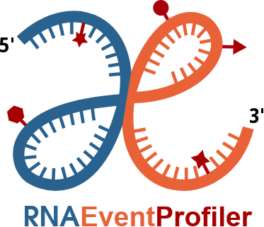

  

<h1 align="center">RNAEventProfiler</h1>

  <strong>Multi-Resolution, Replicate-Aware Differential Analysis of RNA Events</strong>

---
RNAEventProfiler is an R package for differential analysis of RNA modification events from basic modification and coverage tables. The framework is platform-independent, applicable to diverse RNA modifications, and supports complex experimental designs through replicate-aware statistical modeling adapted from established transcriptomics workflows. Its statistical framework can be applied at nucleotide, region, and transcript resolution, enabling multi-resolution analysis of RNA modification changes. 
To facilitate biological interpretation, RNAEventProfiler also provides flexible visualization modules for summarizing site-level, regional, and transcript-level patterns.

The package is still under development but we offer tutorials on two case studies from publicly available data:

- **TRIBE-STAMP demo**: In this demo, we apply the RNAEventProfiler on a randomly selected, yet highly representative subset of 50,000 editing sites from the TRIBE dataset by *Flamand et al. (Genes & Development, 2022)*. Raw data was pre-processed using STAR for read alignment and the Bullseye pipeline for mutation calling.
The original study utilized a TRIBE-STAMP experimental design featuring YTHDF-ADAR and YTHDF-APOBEC1 constructs. For this demonstration, we focus on the HyperTRIBE (A-to-I) events, comparing the YTHDF1-ADAR, YTHDF2-ADAR, and YTHDF3-ADAR constructs against the ADAR control. We provide this dataset to highlight the RNAEventProfiler's unique downstream capabilities.

- **Nanopore demo**: 

The workflow presented in the tutorials covers the following steps and functions:
- ***generate_SE_object***: organizes the event counts, coverage, row and column annotation tables into a SummarizedExperimentObject
- ***run_differential_analysis***: identifies differential events between conditions of interest, handling complex designs and multiple replicates. Relies on EdgeR glm.
- ***aggregate_sites***: aggregates single-nucleotide events into user's defined peaks, regions or at the gene level.
- ***map_to_transcriptome***: performs swift genome-to-transcriptome mapping of event coordinates.
- ***plot_metaprofile***: plots a metaprofile of the aggregated events localization from each transcript.

